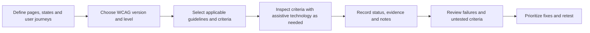

# Accessibility Evaluation in RUXAILAB

Accessibility evaluation checks whether people with different access needs
can perceive, operate, understand, and use a digital product. It can combine
expert inspection, automated checks, and testing with people with
disabilities. These approaches find different kinds of barriers and should
not be treated as interchangeable.

## Current RUXAILAB status

The codebase contains an accessibility module, but the Accessibility study
category is currently marked as **coming soon** in the study-category
configuration. Treat this page as a description of the existing module
capabilities, not a claim that every accessibility workflow is generally
available.

The manual accessibility test model supports a configured WCAG version and
conformance level, selected guidelines and rules, and progress by WCAG
principle. The review flow records criterion statuses such as pass, fail, not
applicable, and untested, with notes.

An automatic accessibility test model is also present. The existence of that
model alone does not establish that a complete automated scanning workflow is
available or that it can verify conformance. Confirm the current interface
and implementation before promising automatic audit coverage.

## Manual expert review workflow

### 1. Define scope and criteria

Document which pages, interactions, content states, and devices are in scope.
Choose the applicable WCAG version and conformance level, then select the
guidelines and success criteria relevant to the product. A bounded scope
makes the review reproducible.

### 2. Inspect and record evidence

Evaluate each criterion against its requirements. Use appropriate browser
tools, keyboard-only interaction, and assistive technologies where the
criterion requires them. Record the affected page or component, reproduction
steps, evidence, impact, and criterion status. Do not mark an untested
criterion as passing.

### 3. Report and retest

Review failures and not-applicable decisions, identify criteria left
untested, and prioritize remediation. Retest the affected flows after fixes.
Report the exact product scope, standard version and level, tools, assistive
technologies, and limitations; a partial review is not a certification.

## Automated checks and user testing

Automated accessibility tools can efficiently detect some code-level issues,
such as certain missing names or invalid relationships. They cannot establish
that content is understandable, that a workflow is usable with assistive
technology, or that all WCAG criteria pass. Combine automated checks with
manual expert review and, where possible, usability testing with people with
disabilities.

## In RUXAILAB

The accessibility implementation lives in `src/ux/accessibility/`. Manual
test configuration includes compliance level and selected criteria, and
progress is tracked by principle and result status. Because the study
category is not yet available generally, verify the current routes and
end-to-end flow before planning a production audit around this module.
