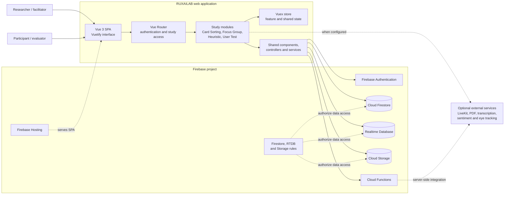
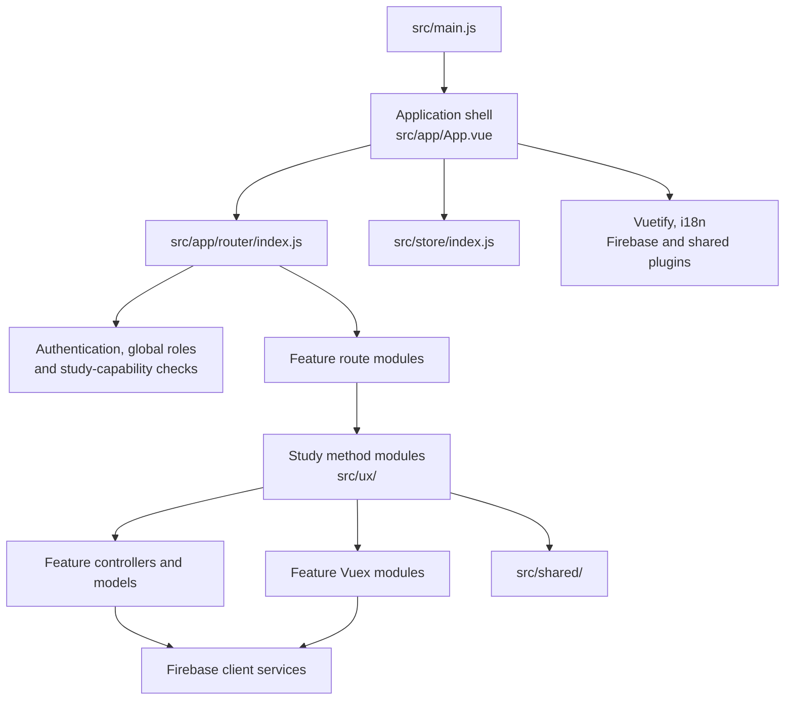
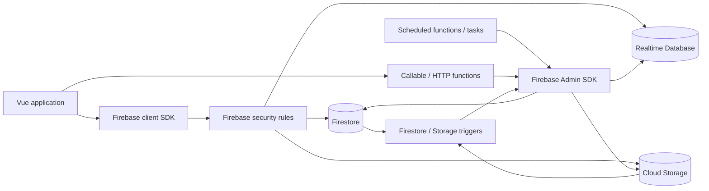
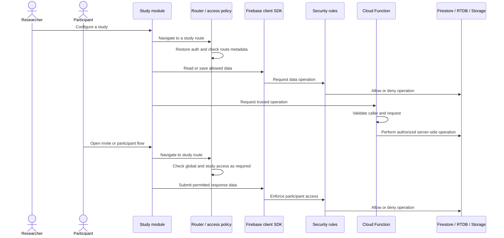

# RUXAILAB Architecture

This page describes how the main parts of RUXAILAB fit together. It reflects
the current Vue and Firebase implementation; optional integrations and study
modules can evolve independently.

## System context

The browser is the presentation and interaction layer. It uses Firebase client
SDKs for authentication and supported data operations; Cloud Functions provide
trusted server-side operations such as callable APIs, HTTP handlers, scheduled
work, and database or storage triggers. Firebase rules enforce data access
independently of what the client UI displays.

## Frontend organization

- `src/main.js` creates the Vue app and installs the router, Vuex, Vuetify,
  localization, and shared plugins.
- `src/app/router/` assembles route groups. `src/app/router/index.js` applies
  authentication and authorization checks, including study-specific
  capabilities where route metadata requires them.
- `src/ux/` contains the study-method modules: Card Sorting, Focus Group,
  Heuristic, and User Test.
- `src/shared/` provides common UI, models, composables, controllers, services,
  utilities, and store modules. Keep code in a method module unless it is
  genuinely shared.
- `src/features/` contains cross-cutting product areas such as authentication,
  dashboard, templates, notifications, and language.

## Backend and data services

- **Cloud Firestore** stores study and answer documents and other application
  data. The exact document shape depends on the study method.
- **Realtime Database** supports real-time state where required, including
  live Focus Group sessions.
- **Cloud Storage** holds files managed by the application.
- **Cloud Functions** are exported from `functions/index.js` and grouped under
  `functions/src/` by HTTP handlers, features, triggers, helpers, and scheduled
  work. The configured runtime is Node.js 24.
- **Security rules** are defined in `firestore.rules`, `database.rules.json`,
  and `storage.rules`. A UI-level permission check is not a substitute for
  rules or server-side authorization.

For example, the Firestore rules deny direct client updates to study documents;
trusted callable operations handle protected study edits and membership
changes. Other data paths have their own rules, so check the specific path and
operation before changing a client controller or a function.

## Study lifecycle and access boundaries

The study module owns its method-specific flow and data model. Shared
authorization code and Firebase rules define which actions are allowed. Keep
these layers consistent when adding a route, role, collection, or callable:

1. Add the relevant route and study-capability metadata.
2. Enforce data access in Firebase rules and trusted server handlers.
3. Validate callable inputs and caller permissions on the server.
4. Add allow and deny tests for the affected access boundary.

## Hosting, local development, and optional services

Firebase Hosting serves the built `dist/` directory and rewrites application
paths to `index.html`, allowing Vue Router to resolve client-side routes. The
Firebase Emulator Suite can provide local Auth, Functions, Hosting, Firestore,
Realtime Database, and Storage services. Emulator hosts and ports are
configured in `firebase.json` and the environment examples.

Optional services such as LiveKit, PDF generation, transcription, sentiment
analysis, and eye tracking are configured separately. They are not required
for every study flow; consult the main repository README and the relevant
service repository before developing against one.

## Related documentation

- [Developer Guide](Developer-Guide)
- [Study methodologies](Study-Methodologies)
- [Focus Group architecture guide](focusgroups)
- [Focus Group analysis guide](analysis)
- [Study activity logging guide](logging)
