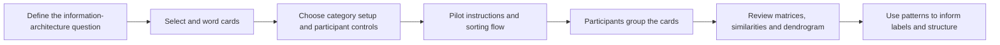

# Card Sorting Methodology

Card sorting helps researchers understand how participants group and label
content. It is commonly used to inform navigation and information
architecture. The result describes patterns in the participants who took
part; it is not, by itself, proof that one taxonomy is universally correct.

## Method choices

- **Open sort:** participants create and name their own groups.
- **Closed sort:** participants sort items into groups defined by the
  researcher.
- **Hybrid sort:** participants start with researcher-defined groups and can
  add or rename groups.

RUXAILAB lets researchers configure categories and whether participants may
create, rename, or delete them. Configure those options to match the intended
protocol and verify the resulting participant view before inviting people.

## Recommended workflow

### 1. Define the question

Decide what content or service structure the sort should inform. Keep the
scope narrow enough that the selected cards can be sorted in one sitting.

### 2. Prepare cards and categories

- Use one concept per card and labels participants can understand without
  additional explanation.
- Include the items relevant to the research question; avoid duplicates,
  ambiguous wording, and an unnecessarily large card set.
- For open sorting, do not impose categories. For closed sorting, define
  categories before the session. For a hybrid sort, decide which categories
  can be added or renamed.
- Write neutral task instructions and pilot them with someone who is not
  designing the taxonomy.

### 3. Run the study

Participants review the instructions and any configured pre-test questions,
then move cards from the unsorted pool into categories. Depending on study
settings, they may also create or rename categories. Keep participation
voluntary and provide the study's consent information before collecting
responses.

### 4. Interpret results

RUXAILAB's results view includes participant and card/category counts, total
and sorting times, dendrograms, card matrices, similarity matrices, timelines,
and pre-test distributions when available.

- Use a **similarity matrix** to identify pairs of cards participants
  frequently placed together.
- Use a **dendrogram** to explore possible clusters; inspect the original
  groupings before choosing a cut or category boundary.
- Compare labels and groups qualitatively, especially where participants
  created their own categories.
- Consider participant characteristics and task context when interpreting a
  pattern. A frequent grouping is a signal to investigate, not an automatic
  design decision.

## Limitations

Card sorting reveals participants' mental models for the selected items and
task framing. It does not directly test whether a proposed navigation is
findable or successful; a follow-up tree test or usability test may be needed.
Small or highly specialized samples should be interpreted as exploratory
evidence.

## In RUXAILAB

The feature is implemented in `src/ux/CardSorting/`. The study setup defines
cards, categories, category descriptions, and participant category controls.
The participant flow includes optional pre- and post-test questions.

For developer documentation, start with the
[Card Sorting module](https://github.com/ruxailab/RUXAILAB/tree/develop/src/ux/CardSorting)
and the [study-method addition guide](https://github.com/ruxailab/RUXAILAB/blob/develop/docs/adding-a-study-method.md).
