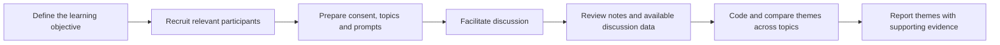

# Focus Group Methodology

A focus group is a facilitated discussion with a small group of participants.
It is useful for exploring experiences, reactions, vocabulary, motivations,
and different perspectives. The interaction among participants can surface
ideas that individual questionnaires may not reveal.

A focus group is qualitative research. The number of comments expressing a
view should not be treated as a population estimate, and a quiet participant
should not be assumed to agree with the group.

## Recommended workflow

### 1. Plan the session

- Define a focused research question and participant criteria.
- Prepare a short discussion guide with open-ended prompts, ordered from
  introductory questions to the core topics.
- Use neutral questions that do not lead participants toward a preferred
  answer. Prepare follow-up prompts that invite examples and reasons.
- Decide the facilitator and observer responsibilities, the session length,
  group size, consent process, and how notes or recordings will be handled.
- Pilot the prompts and any stimuli before the research session.

### 2. Facilitate the discussion

Explain the purpose, consent, privacy expectations, and ground rules. Invite
participants to speak in turn, ask for examples, and make room for different
views. Avoid endorsing a participant's answer or allowing a single voice to
dominate. Use topic-linked stimuli only when they help answer the research
question.

### 3. Analyze and report

Review the discussion evidence by topic. Code meaningful statements, compare
recurring and contrasting views, and preserve context and quotes for important
findings. Distinguish a participant's own statement from a facilitator
interpretation. Report how the group was recruited and moderated, and describe
findings as qualitative themes rather than representative percentages.

## In RUXAILAB

The Focus Group module supports a discussion guide with topics, consent text,
topic-linked stimuli, scheduled or live sessions, breakout groups, chat,
observer notes, and participant engagement information. After a session, a
facilitator can review themes and generate analysis.

The default server-side analysis processes recorded chat text by topic. It can
provide extractive summaries, candidate phrases and themes, lexical wording
similarity, and cautious quote-backed stance cues. These are review aids:
wording similarity is not a measure of agreement, and automated stance cues
are not definitive findings. Optional model-based synthesis is a separate
facilitator action.

The current analytics do not analyze spoken audio or video. LiveKit provides
the call transport but does not persist a full-session recording in this
module. Do not interpret chat coverage as spoken participation or use it to
infer that a participant did not contribute.

For the data/session architecture and analysis limitations, see the
[Focus Group developer guide](focusgroups) and
[Focus Group analysis guide](analysis).
