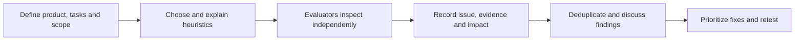

# Heuristic Evaluation Methodology

Heuristic evaluation is an expert inspection method. Evaluators review an
interface against an explicit set of usability principles and document where
the design may cause difficulty. It is useful for finding and prioritizing
potential usability issues; it is not a substitute for observing users.

## Recommended workflow

### 1. Prepare the evaluation

- Choose the interface, device context, and core workflows to inspect.
- Select a heuristic set that fits the product and explain each criterion.
- Recruit evaluators with relevant expertise and provide the same study
  instructions.
- Decide how evaluators should document a potential issue and which rating
  scales they will use. Pilot the form for clarity.

### 2. Inspect and document

Evaluators review the interface and assess each configured heuristic
question. Record the affected screen or workflow, reproducible evidence, the
expected behavior, the observed issue, and a concrete recommendation. Apply
ratings consistently; distinguish the frequency or severity of a problem
from evaluator confidence or supporting evidence.

If multiple evaluators are involved, independent reviews before a joint
discussion can reduce early influence from other evaluators. Reconcile
duplicate reports after individual inspection while retaining disagreements
that reflect different interpretations.

### 3. Interpret results

RUXAILAB can aggregate configured evaluator answers. The traditional report
includes averages, minimums, maximums, and standard deviations for frequency
and severity, along with evaluator, comment, and image counts.

Review the issue-level evidence as well as summary statistics. A mean rating
does not explain the context of a usability problem, and differences among
evaluators may indicate ambiguous criteria or a need for further user
research. Prioritize issues using their impact, scope, evidence, and
implementation cost rather than a score alone.

## In RUXAILAB

Researchers configure the heuristic set, questions, response controls,
answer options, weights, and evaluator settings. Evaluators answer each
question and can provide comments, images, and recommendations.

The feature lives in `src/ux/Heuristic/`. Preserve the distinction between
global user roles and study-specific capabilities when configuring access or
adding routes.

Heuristic findings are expert predictions of usability problems. Validate
high-impact or uncertain findings with representative users when practical.
