# Study Methodologies in RUXAILAB

RUXAILAB organizes its available research methods under three active study
categories: **Test**, **Inquiry**, and **Inspection**. The application
currently provides four study-method modules. Accessibility is represented by
a separate module, but its category is marked as coming soon; see the
[Accessibility Evaluation note](Accessibility-Methodology) for that status.

| Study method | Category | Main purpose | Guide |
| ------------ | -------- | ------------ | ----- |
| Card Sorting | Test | Discover how participants group and label information. | [Card Sorting methodology](Card-Sorting-Methodology) |
| Focus Group | Inquiry | Explore attitudes and ideas through facilitated group discussion. | [Focus Group methodology](Focus-Group-Methodology) |
| Heuristic Evaluation | Inspection | Identify usability issues through expert review against heuristics. | [Heuristic Evaluation methodology](Heuristic-Evaluation-Methodology) |
| User Testing | Test | Observe users completing tasks and evaluate usability. | [User Testing methodology](User-Testing-Methodology) |

## Shared research workflow

```mermaid
flowchart LR
    Question[Define research question] --> Method[Choose a method]
    Method --> Plan[Plan study and participant/evaluator criteria]
    Plan --> Configure[Configure study in RUXAILAB]
    Configure --> Consent[Explain participation and obtain consent as required]
    Consent --> Collect[Collect responses or evaluations]
    Collect --> Review[Review evidence and method-specific analysis]
    Review --> Findings[Report findings with limitations]
```

RUXAILAB provides tools for configuring studies, gathering data, and
visualizing results. The platform's metrics and automated analysis support
research; they do not replace research design, participant protection, or
interpretation of the original evidence.

## Choose a method

- Choose **Card Sorting** when the question concerns how people group or name
  items, especially when designing or revising information architecture.
- Choose a **Focus Group** to explore perceptions, language, motivations, and
  differences of opinion through a moderated discussion.
- Choose **Heuristic Evaluation** when evaluators can inspect an interface
  against a defined set of usability principles and report issues.
- Choose **User Testing** when you need to observe representative users
  completing realistic tasks and assess task outcomes and experience.

These methods answer different questions. A score or theme from one method
should not be treated as a substitute for evidence collected by another.

## Documentation scope

The method guides describe the workflow supported by the current application
and practical research considerations. Exact screens, fields, metrics, and
analysis behavior can change; confirm current behavior in the source module
and its tests before extending the product.
