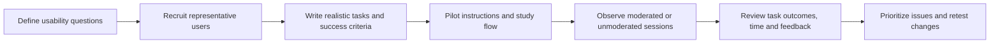

# User Testing Methodology

Usability testing observes representative users attempting realistic tasks
with a product. It helps identify where people succeed, struggle, make errors,
or need assistance. Testing is strongest when tasks reflect real user goals
without revealing the intended path.

## Moderated and unmoderated sessions

- **Moderated testing:** a facilitator observes the participant and may ask
  neutral follow-up questions. It is useful for understanding why an issue
  occurs, but the facilitator can influence behavior.
- **Unmoderated testing:** participants complete tasks independently. It can
  support more sessions, but task instructions and success criteria must be
  clear because the facilitator cannot clarify them during the session.

Choose the format based on the research question, participant needs, privacy
requirements, and available support.

## Recommended workflow

### 1. Design the study

- Identify the target users and the product workflows to evaluate.
- Write task scenarios around user goals, not interface instructions. Avoid
  giving away the correct control or navigation path.
- Define observable completion criteria before testing and decide how to
  treat partial completion, errors, timeouts, and requests for help.
- Choose a session format, consent and recording approach, questionnaires,
  and a plan for handling participant data.
- Pilot the tasks with someone representative of the intended participants.

### 2. Run sessions

Provide consistent instructions and obtain consent before collecting data.
Ask participants to think aloud only when it fits the study and explain that
the interface, not the participant, is being evaluated. In moderated studies,
use neutral prompts and avoid teaching the participant how to complete the
task.

### 3. Analyze evidence

RUXAILAB supports ordered tasks and task-level outcomes, including whether a
task was attempted or completed, success, and elapsed time. The user-testing
analytics include task success rates, effectiveness, efficiency, satisfaction
measures such as SUS where available, and time comparisons.

Interpret metrics in context:

- **Effectiveness:** whether participants achieved the defined task outcomes.
- **Efficiency:** the time or effort needed to achieve those outcomes, using
  the study's defined task and time data.
- **Satisfaction:** participants' reported experience, including SUS where
  collected.

These dimensions are complementary. A short completion time does not imply
success if the task was incomplete, and a satisfaction score does not identify
the cause of a problem. Review observations, participant comments, and task
context before prioritizing changes.

## In RUXAILAB

The User Test module supports an ordered task structure, task-specific
settings, moderated and unmoderated flows, questionnaires, and optional
recording, transcription, or mobile-task integrations where configured.
Setup and integrations vary by study; verify availability and consent
requirements before enabling them.

The feature lives in `src/ux/UserTest/`. For implementation details, follow
the existing task models, answer lifecycle, and tests rather than assuming
that every optional integration is active in every environment.
